# ExploreX Travel Knowledge Retrieval

## Implemented design

ExploreX uses the existing PostgreSQL application database and a pgvector extension as the initial vector store. No Qdrant service was added: the current curated corpus is five small factual records, so another service would add operations without a measured need. The migration creates a 1536 dimensional vector column, a cosine HNSW index, and a PostgreSQL GIN full-text index. Structured destination/category filters and a coordinate index run before candidates are ranked. Geographic filtering uses an indexed bounding box followed by a Haversine radius check.

```mermaid
flowchart LR
  SR[Source registry and reuse policy] --> C[Curated corpus validation]
  C --> I[Idempotent ingestion]
  I --> N[Normalize, hash, deduplicate, chunk]
  N --> E[Optional OpenRouter embeddings]
  N --> PG[(PostgreSQL documents and chunks)]
  E --> PG
  PG --> F[Verified status, lifecycle, owner, taxonomy and geo filters]
  F --> V[pgvector semantic candidates]
  F --> K[PostgreSQL FTS candidate set]
  K --> B[BM25 rerank]
  V --> R[Reciprocal-rank fusion]
  B --> R
  R --> A[Traceable evidence and retrieval metrics]
  A --> G[Planner evidence sufficiency gate]
  G -->|sufficient| L[LLM planner with evidence as untrusted data]
  G -->|incomplete| U[Explicit uncertainty response]
```

### Source registration and permitted content

The registry is runtime-validated against `data/catalogs/source-registry.json`. The initial corpus contains five records: the Jaipur destination identity and the names Amber Palace, City Palace, Jantar Mantar, and Hawa Mahal. It stores only allowed factual names from sources whose registry marks current use and explicit attribution-required reuse with a narrow factual-name policy. Terms-unclear, candidate-only, ephemeral, or broader source policies are not indexed. Jaipur city-center coordinates are excluded because their source terms are unclear. No page text, photos, user data, AI-generated text, current prices, hours, ratings, availability, or travel times are ingested.

Each stored document includes source and source-document identifiers, version, canonical destination/category metadata, fact types, language, verification state, source URL, attribution, license, storage policy, content and record hashes, verification timestamp, and ingestion timestamp. Chunks have deterministic identifiers and hashes. Private records have owner scoping in the schema and search predicates; the present corpus ingester imports public records only.

### Ingestion and lifecycle

`npm run rag:validate` validates and reports a dry run without connecting to PostgreSQL. `npm run rag:ingest` applies the reviewed corpus after the migration is deployed and `DATABASE_URL` is configured. Source registrations upsert by stable ID. Document identity is `(sourceId, sourceDocumentId, version)` with one partial unique current-version index. Re-running unchanged content does not create a version or call embeddings again. Metadata changes create a version; content changes are rechunked and embedded when credentials exist. A model change requires re-embedding before that model's vectors are made active. Removed or newly disallowed records are deleted and their chunks cascade. Invalid records, provider failures, and blocked source policies are written to the quarantine table with bounded details and reported in the command summary.

Embeddings use the server-only `OPENROUTER_API_KEY`, `RAG_EMBEDDING_MODEL`, and `RAG_EMBEDDING_DIMENSIONS=1536`. External responses are Zod-validated for shape, ordering, count, and dimensions. Requests time out and have one bounded retry for retryable network, timeout, quota, and server failures. Embedding input is the minimal permitted factual content. Token usage, estimated cost (only when `OPENROUTER_EMBEDDING_COST_PER_MILLION_USD` is configured), latency, failure class, and retrieval method are logged without content or credentials.

### Retrieval and safeguards

Retrieval first validates a bounded query and applies active/current status, allowed verification state, destination, category, language, visibility/owner, and optional geographic filters. Semantic search uses pgvector cosine distance when an API key and database are available. A failure falls back to keyword search. Keyword retrieval uses PostgreSQL full-text search to bound candidates, then a tested in-process BM25 ranker. Reciprocal-rank fusion combines ranked lists. Search returns source URL, attribution, license/storage policy, verification status, last-verified date, source and document IDs, version, and retrieval time.

There is no fixed global vector-similarity cutoff. Result ranking is evaluated in the offline set below; the planner separately requires explicit fact coverage for identity, at least three place names, place coordinates, addresses/details, and accommodation records plus price, address, coordinates, and rating before invoking the LLM. Incomplete or unknown destinations return a structured uncertainty response with missing evidence and any retrieved citations. Retrieved content is passed as serialized untrusted data and the planner system prompt says never to follow its instructions. The LLM is not called for the present Jaipur corpus because it cannot support a complete itinerary.

Private records are only eligible when `ownerId` matches the local `User.id` resolved from the server-authenticated Clerk ID; the client cannot supply either identity. If no local account row exists, only public records can match. The ingestion script does not import private trips, conversations, or profile data. The current retrieval route is server-only and bounded to 12 evidence items. Query strings are parameterized and passed through PostgreSQL `websearch_to_tsquery`, not interpolated into SQL.

## Offline evaluation

Run `npm run rag:evaluate`. The set has eight representative queries: five Jaipur identity/attraction-name lookups, two Jaipur requests for facts absent from the data (accommodation and opening hours), and one unsupported Varanasi event query. This is a small regression set, not evidence of India-wide coverage.

Results for the current five-document corpus:

| Measure | Result |
|---|---:|
| Evaluation queries | 8 |
| Queries with known relevant records | 5 |
| Unsupported queries expected to abstain | 3 |
| Keyword Recall@5 on supported queries | 1.00 |
| Mean reciprocal rank on supported queries | 1.00 |
| Semantic retrieval evaluation | Not run: offline evaluator does not connect to the vector store or embedding provider |

The eval script reports relevant IDs/ranks and expected abstentions. The contract tests verify the planner evidence gate rejects this incomplete corpus. These numbers only describe the deliberately lexical, tiny Jaipur set and must not be generalized to semantic quality or other destinations. The two unsupported Jaipur field queries can still return the destination identity record by lexical overlap; the evidence gate identifies the missing fact types and prevents the LLM call.

## Database rollout and operational limits

The read-only `npm run rag:db-check` reached the configured Neon PostgreSQL 17.11 database (`neondb`). The six pre-RAG migrations, the Phase 5 RAG migration, and the Phase 6 planner migration have since been applied and verified with Prisma; the check confirms `agent_runs` and `agent_tasks` exist. pgvector is installed and available. The database is ready for the planner schema, but its live public knowledge corpus still contains only five Jaipur documents (destination identity and four attraction names). It does not meet the evidence gate for a complete itinerary, so live itinerary generation must continue to return insufficient evidence. The preflight reports schema readiness separately from evidence presence and lists per-destination public document counts. Prisma does not model generated `searchVector` or the vector/HNSW index; those remain maintained in SQL migrations.

Applying migrations establishes schema only; it does not establish city coverage or verified place and accommodation facts. Expand the corpus only with source records whose reuse policy permits the specific stored facts, then validate and ingest them with `npm run rag:validate` and `npm run rag:ingest`. Do not relax the evidence gate to compensate for missing data.

The current code assumes PostgreSQL `vector(1536)` and `openai/text-embedding-3-small` by default. Changing dimensions requires a coordinated schema migration and rebuild. Changing model requires a full vector rebuild. The database uses application pool connections for retrieval; production pool sizing must account for web workers. No background queue is introduced: ingestion is a bounded operator-run command. For larger corpora, move ingestion to the existing background-job infrastructure only after measuring runtime and lock pressure. There is no automated source recrawl, scheduled freshness job, or semantic relevance threshold calibration yet.

## Files and commands

- Schemas and retrieval: `lib/rag/`.
- Migration: `prisma/migrations/20261108000000_travel_knowledge_rag/`.
- Curated records: `lib/rag/curated-corpus.ts`; source terms: `data/catalogs/source-registry.json`.
- Offline set: `data/rag/evaluation.json`.
- Commands: `npm run rag:db-check`, `npm run rag:validate`, `npm run rag:evaluate`, and `npm run rag:ingest`.
- Required server configuration: `DATABASE_URL`, `OPENROUTER_API_KEY`; optional `RAG_EMBEDDING_MODEL`, fixed `RAG_EMBEDDING_DIMENSIONS=1536`, and `OPENROUTER_EMBEDDING_COST_PER_MILLION_USD`.
