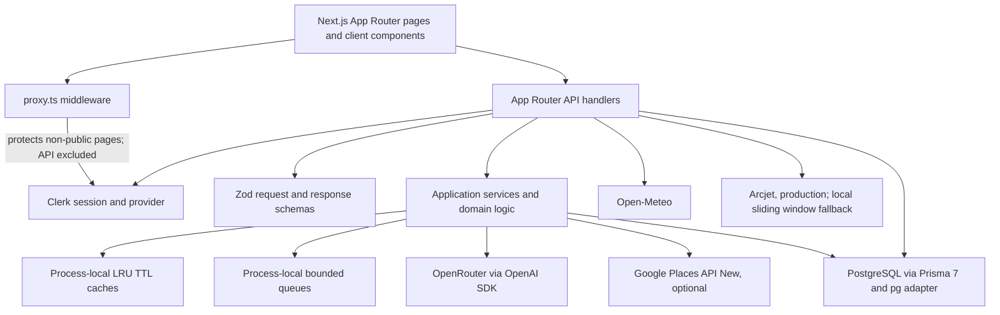

# ExploreX architecture (repository audit)

Audit snapshot: 2026-10-27. This document describes the checked-in application. Provider availability and production deployment state are not inferred from local configuration. Phase 1 contracts are summarized below; see `docs/DECISIONS/` for the accepted decisions.

## System map

Middleware intentionally leaves `/api(.*)` public at the middleware boundary. API handlers are responsible for authentication, public access validation, ownership, and rate limiting. `/api/reminders/due` instead uses a cron bearer secret.

## Repository boundaries

- `app/`: Next.js App Router pages, layouts, route handlers, planner interface, city pages, saved trips/cities, admin and travel signals.
- `app/api/`: handlers for users, trips, AI, destinations, weather, city guides, saved cities, stories, reminders, site datasets, statistics and admin analytics.
- `app/create-new-trip/_components/`: preference/chat collection, generated-plan dashboard, itinerary panels and export.
- `components/`, `context/`, `hooks/`: shared visual components, client state and UI hooks.
- `lib/ai/`: versioned prompts, OpenRouter client calls, response parsing, retry/timeout errors and cache keys.
- `lib/travel-data/`: provider contract, optional Google Places exact-name matching, source labels and saved-plan source sanitization.
- `lib/algorithms/`, `lib/trip-optimizer.ts`: pure search, Haversine/route ordering, scheduling, budget allocation/knapsack, ranking, cache and local rate limiting.
- `lib/domain/`: Zod schemas, types and ownership predicates.
- `lib/data/`: curated destinations, city guides, travel signals, AI feature prompts and site datasets.
- `lib/observability/`: redacted structured request/provider logs and best-effort AI analytics.
- `prisma/`: PostgreSQL Prisma schema and five committed migrations. `lib/generated/prisma/` is generated and ignored.
- `scripts/`: legacy DB seed and city-guide/site-dataset seed scripts.
- `docs/`: architecture, security, performance, earlier audits and quality report.

## Phase 1 domain boundaries

`lib/domain/travel.ts` is the canonical provider-neutral contract layer. It models destinations, places (shared by experiences/restaurants/hotels), route legs, weather observations, guides, discoveries and itinerary activities. Money estimates carry ISO currency and a unit; source metadata can differ at entity and price level. `lib/travel-data/legacy-trip-adapter.ts` maps existing AI trip data into these contracts without guessing unresolved country or currency values. Source states and freshness fields are defined in [ADR 0001](./DECISIONS/0001-domain-contracts.md).

`lib/travel-data/ports.ts` defines provider inputs and canonical outputs. Implementations translate vendor structures inside adapters. Existing saved-trip AI JSON and routes remain compatible; `TravelDataProvider` no longer returns `unknown` for unavailable route/weather/currency capabilities. New typed application errors live in `lib/domain/errors.ts`; `lib/env.ts` parses optional server settings at DB, AI, Places, admin and cron feature boundaries, and request correlation parsing is exported from request metrics. See [ADR 0002](./DECISIONS/0002-application-boundaries.md) for dependency direction and gradual migration rules.

## Phase 2 destination catalog

`data/` owns structured destination files, multi-label taxonomy, per-record evidence and source/license manifests. Zod contracts are defined in `lib/domain/dataset-schemas.ts`; application search takes Jaipur's city coordinate and alias from the validated catalog. `GET /api/catalog/jaipur` reads the imported `site_datasets` records only when catalog, taxonomy and manifest validate, then falls back to the checked-in catalog. `npm run data:validate` validates and quarantines without database writes; `npm run data:import:jaipur` applies via transactional upserts. The starter set does not claim complete Jaipur or India coverage. See [data update and source policy](../data/README.md).

## Trip-generation path

1. The landing hero builds a natural-language idea and routes signed-in users to `/create-new-trip`; unauthenticated users go through Clerk sign-in. The planner also has a structured preferences form and conversational UI in `ChatBox`.
2. `ChatBox` sends client-held message history to `POST /api/aimodel`. The handler requires Clerk auth, bounds and validates JSON/message history, applies chat/final rate limits, and wraps the request in HTTP metrics.
3. For intermediate chat, the handler constructs a prompt and sends the request to `generateAiResponse`. For final requests, it checks the process-local LRU cache keyed by user, prompt version, model and normalized messages, then calls OpenRouter via the OpenAI SDK when there is a miss. Requests use a bounded local queue, timeout, exponential retry, safe JSON extraction and Zod schemas.
4. Final AI candidates pass through optional `attachTravelSources`: when `GOOGLE_MAPS_API_KEY` is configured, a bounded number of hotel/activity/restaurant names are searched against Google Places and exact normalized names can be marked matched. Only name/listing identity and a generated Google Maps place link are retained; coordinates, ratings, hours, prices, photos, availability, and booking are not validated. With no key candidates are labeled AI-generated/unavailable.
5. `optimizeTripPlan` ranks hotels/restaurants, orders stops with nearest-neighbor plus 2-opt, schedules feasible activities, allocates a modeled budget and scores heuristic quality. No route adapter is configured, so distance is Haversine straight-line estimate and travel times are not road/transit routing. The final schema is validated again.
6. The response returns to the browser and is transformed for display in `lib/trip-transform.ts`; the UI may assign category-based Unsplash images. Generated plans remain in client context until the user explicitly saves.
7. `POST /api/trips` re-authenticates and validates a bounded plan, sanitizes source claims, computes a per-user hash, then transactionally creates the trip, hotel rows, normalized day/activity rows and analytics event. The full plan JSON remains on `Trip`. Saved-trip list/detail APIs use owner-scoped queries; rendering uses the saved JSON.

AI feature answers use a separate `/api/ai-features` path with bounded request schema, specialized local prompts, queue/rate limits and output from OpenRouter. They are not grounded in retrieval sources.

## Existing capabilities to preserve

- Clerk sign-in/sign-up and per-handler authorization; owner-scoped saved trip/reminder/city APIs; role/allowlist admin analytics.
- Trip preference form/chat, validated structured itinerary generation, explicit save, per-user duplicate detection, saved trip filtering/pagination/favorites/duplicate/delete/export, city guide browsing/bookmarks, public curated content, weather lookup for recognized catalog destinations, reminders as stored records, and admin analytics.
- Pure algorithm modules for fuzzy/trie destination search, route ordering, feasibility scheduling, budget split/knapsack and candidate ranking.
- PostgreSQL persistence with migration history, normalized queryable itinerary rows, timestamps with time zone, money projection fields and supporting indexes.
- Input size/schema limits, AI/provider timeouts and retries, bounded process-local queues, rate limiting, source labels, safe external-link handling in reviewed flows, security headers, structured logs and route-level mocked security regression tests.

## Trust and data boundaries

- Model-generated venue identities, coordinates, ratings, addresses, prices, hours, and availability are estimates. Google Places exact-name matching does not make those other attributes verified. Weather is live from Open-Meteo only when the weather API is used.
- Destination suggestions and city guide catalogs are local editorial/static content; DB guide rows are seeded copies, not a live travel inventory. The public stories endpoint maps the first three curated guides into a diary-shaped response; the visible component still calls them real itineraries/live database/server intel. This is a content/provenance mismatch.
- Maps link out to Google Maps; embedded coordinates can be model-generated. Maps are not an authoritative route provider. Unsplash images can be category-based illustrations unrelated to named places.
- Request-controlled external fetch URLs were not found in the inspected weather/Places routes: they use fixed provider origins. Saved-plan image URLs are sanitized to allowed hosts. Future outbound URL fields need explicit scheme/host rules.
- No cross-user IDOR was found in the inspected trip, reminder, city-save, or admin paths. Middleware's public API matcher means new handlers must keep their own authorization and validation. Tests mock auth/database and do not exercise a real deployment.

## Persistence, deployment and migration concerns

- Prisma 7 uses the `prisma-client` generator into `lib/generated/prisma`; runtime uses `@prisma/adapter-pg` with `DATABASE_URL`. Prisma CLI uses `DIRECT_URL` from `prisma.config.ts`. README calls for pooled runtime and direct migration URLs.
- `Trip.plan` JSON is the full validated snapshot; `TripDay`/`TripActivity` and `TripHotel` overlap as queryable projections; legacy `ItineraryItem` remains. New saves use relational days/activities, while renderer/API details currently read JSON. Define which representation is authoritative before new edits.
- Money is partly text and partly integer minor-unit projections; currency code is optional. No exchange-rate provider or trip start/end persistence exists in relational models. Reminder dates store a UTC instant and IANA timezone.
- Five migrations include additive tables/columns, enum conversions and a JSON backfill. The persistence-hardening migration aborts on unsupported user/reminder enum values and interprets legacy timestamp-without-time-zone values as UTC. Production rollout needs backup/restore verification, data preflight and migration rehearsal.
- There is no PostGIS extension, geography column, geospatial index, or geographic SQL query. Coordinates are optional floats with range validation only.
- AI/provider queues and caches are in-process, not durable/shared. There is no background job service; due-reminder endpoint only returns up to 100 due rows and does not claim/deliver/advance them. Arcjet is required for production rate limiting as documented; no external APM, Web Vitals collector, CI workflow, Docker config or scheduler manifest was found in the scanned repository files.
- No dependency additions are recommended solely for this audit. A shared cache/queue, PostGIS, booking/travel inventory or observability vendor requires a measured/product requirement and separate decision.

For prioritized findings and phase dependencies, see [IMPLEMENTATION_ROADMAP.md](./IMPLEMENTATION_ROADMAP.md). For route-level risks and actual baseline commands, see [EXISTING_SYSTEM_AUDIT.md](./EXISTING_SYSTEM_AUDIT.md).
