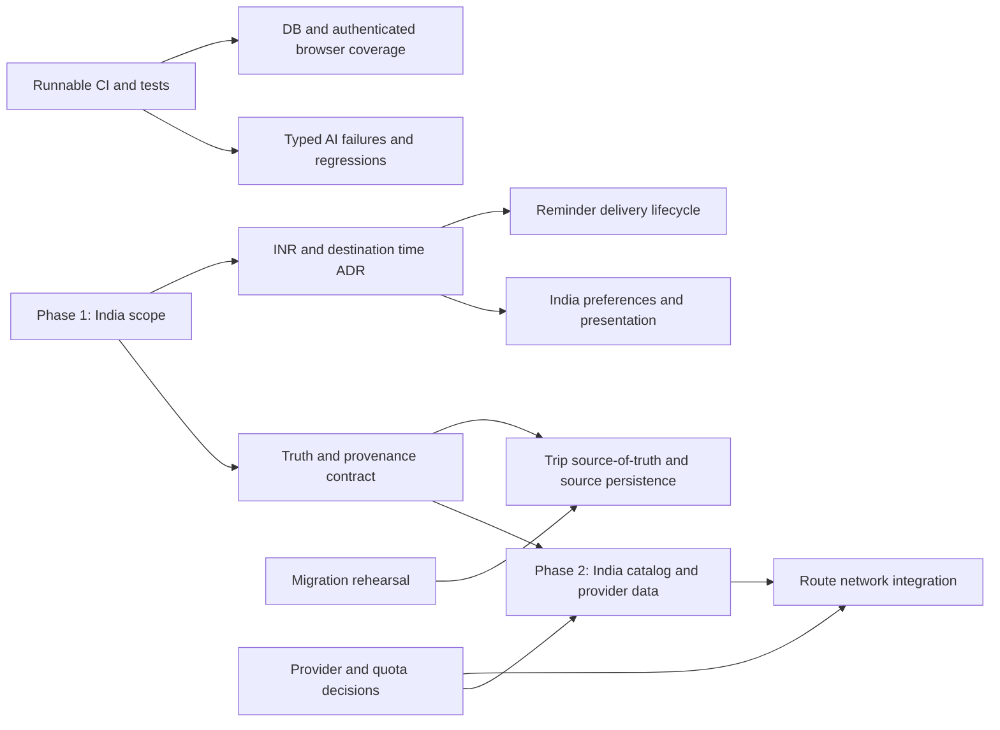

# ExploreX India-first implementation roadmap

Roadmap prepared from the repository audit dated 2026-10-27. It is an ordered backlog, not authorization to perform a product refactor. Preserve current saved data, global destination support and working planner flows while India-specific capabilities are added.

**Phase 1 status:** Canonical contracts, typed provider ports (including non-`unknown` unavailable capability results), a no-invention legacy-plan adapter, domain errors, shared environment parsing at feature composition points, request correlation helper reuse, provenance correction for exact Google listing matches, tests and architecture decisions are implemented additively. Existing API/persistence/UI wire DTO migration and full live provider adapters remain future work. See [ADR 0001](./DECISIONS/0001-domain-contracts.md) and [ADR 0002](./DECISIONS/0002-application-boundaries.md).

**Phase 1 checks (2026-10-27):** `npm run lint`, sequential `npm run typecheck`, and `npm run prisma:validate` passed. `npm test` failed during Vitest/Vite config startup with Windows `spawn EPERM`, before test execution. `npm run build` compiled in 13.3s, then failed starting Next's TypeScript worker with `spawn EPERM`; standalone typecheck passed. A concurrent initial check briefly caused Prisma generation `ENOENT`; sequential rerun passed. No code-level assertion failure was reported.

## Guiding constraints

- Prefer additive migrations and reversible UI/data changes; do not delete existing features or records.
- A schema-valid model result is not a verified travel fact. Keep estimates, provider results, curated editorial content and user-provided facts distinguishable end-to-end.
- Do not add infrastructure until a concrete product requirement, India coverage, operational owner, cost, latency and fallback path are established.
- Keep route ownership predicates, validation, body limits, rate limits and secure failure responses as API invariants.
- Keep data-source terms, attribution, freshness and privacy/retention requirements in scope when introducing travel providers.

## Prioritized backlog

### P0 — Release blockers

No confirmed P0 code defect was identified in this repository inspection. P0 is reserved for launch-critical issues found during staging or before a concrete India launch, rather than promoting unverified assumptions:

- Block rollout if staging finds a cross-user data leak, broken migration/restore path, secret exposure, or production rate limiting/authentication disabled.
- Block factual “verified/live/current” product claims until source evidence and a field-level provenance contract exist.

### P1 — Next phase foundation

| ID   | Scope                                                                                                                                                                                             | Acceptance evidence                                                                                                                                  | Dependencies                                                                    |
| ---- | ------------------------------------------------------------------------------------------------------------------------------------------------------------------------------------------------- | ---------------------------------------------------------------------------------------------------------------------------------------------------- | ------------------------------------------------------------------------------- |
| P1.1 | Agree India-first product scope: user segment, initial states/cities, domestic/inbound/outbound trip support, India languages, traveler requirements, and which global flows stay supported.      | Product brief names target segments, initial geography, language plan, excluded claims and success measures.                                         | Product owner decision; no code dependency.                                     |
| P1.2 | Define provenance contract for generated, curated, user-entered, exact-name-matched and provider-sourced fields; audit itinerary, city guide, map, export and marketing labels.                   | Field/source/freshness table; no “live/verified/database itinerary” labels without supporting source; uncertainty survives display/export.           | P1.1; data-provider strategy.                                                   |
| P1.3 | Correct the diary source mismatch and hide or clearly label generated illustrations/heuristics (category Unsplash photos, fallback ratings/costs, modeled transport/advice).                      | Visible labels match API response/source; generated images cannot be mistaken for actual venue images; export says estimates.                        | P1.2.                                                                           |
| P1.4 | Make AI chat failure responses typed and observable; separate valid assistant content from provider/schema/timeout/rate-limit errors and preserve retry affordance.                               | Tests prove 503/504/502 remain errors, safe messages reveal no secrets, client does not append fallback as valid AI turn.                            | P1.2; test baseline.                                                            |
| P1.5 | Establish repeatable CI baseline for lint, typecheck, Vitest and production build; reproduce/resolve Windows `spawn EPERM` or use supported Linux CI and report environment/toolchain accurately. | CI run records actual exit status; minimum algorithm and route security suites execute; build completes in supported CI.                             | None, but verify no environment variables/secrets are required just to compile. |
| P1.6 | Specify INR/currency and time semantics before India plan persistence changes. Add explicit currency provenance and destination-local date/time behavior in a compatibility design.               | ADR defines ISO currency, integer minor units (INR paise), timezone source, legacy string handling, and migration/backfill/rollback plan.            | P1.1 and P1.2.                                                                  |
| P1.7 | Rehearse current and proposed migrations on disposable copy; review JSON backfill, enum/timestamp preconditions and restore process.                                                              | Rehearsal evidence includes before/after counts, known rollback/restore, migration duration and lock notes; no production migration from this phase. | Database owner/staging copy.                                                    |

**Phase 1 exit:** accepted product brief and provenance/currency/time ADRs; CI checks runnable; P1 source/AI semantics fixed or scoped with dates; migration rehearsal process available. No broad UI rewrite.

### P2 — India MVP capabilities

| ID   | Scope                                                                                                                                                                                | Acceptance evidence                                                                                                                                                                           | Dependencies                                                     |
| ---- | ------------------------------------------------------------------------------------------------------------------------------------------------------------------------------------ | --------------------------------------------------------------------------------------------------------------------------------------------------------------------------------------------- | ---------------------------------------------------------------- |
| P2.1 | Add India destinations/states and city/local content as additive curated data; keep global catalog and legacy slugs intact.                                                          | Catalog supports agreed launch regions, aliases/English/local names as selected, coordinates with source/confidence, and fallback behavior; existing city links and saved-city slugs resolve. | P1.1, P1.2; editorial/data ownership.                            |
| P2.2 | India-localized preference entry and presentation: INR formatting, locale-aware dates, Asia/Kolkata destination time, India traveler preferences where agreed.                       | Structured request/schema and exports retain currency/timezone; no currency inference from browser locale; old saved plans still render.                                                      | P1.6; P2.1.                                                      |
| P2.3 | Evaluate and integrate selected India-capable geocoding/place provider for identity and coordinates with explicit confidence/source/freshness; no fake coordinate validation.        | Provider terms, India coverage and quotas recorded; matched identity and coordinate provenance are distinct; mismatch/unavailable paths tested.                                               | P1.2, provider evaluation; can be phased after curated-only MVP. |
| P2.4 | Add road/transit distance/time only after provider strategy; retain straight-line distance as a clearly named fallback.                                                              | Optimization and UI identify per-leg source; no generated travel time shown as provider route; timeout/quota fallback tested.                                                                 | P2.3; route provider decision.                                   |
| P2.5 | Define reminder delivery product and worker lifecycle (claim/lease, retry, idempotency, notification, time-zone semantics).                                                          | Repeated/concurrent due polling cannot double-deliver or starve rows; user-visible delivery state and operational monitoring defined.                                                         | P1.6; notification channel and scheduler decision.               |
| P2.6 | Define trip-source-of-truth and update persistence projections; retain Trip.plan compatibility while deciding role of normalized hotel/day/activity rows and legacy itinerary items. | Round-trip and backfill tests show JSON/relational projections consistent; source metadata not collapsed; migration is additive and reversible by restore.                                    | P1.2, P1.7.                                                      |
| P2.7 | Add PostgreSQL integration tests and authenticated browser flows using disposable DB/accounts.                                                                                       | Tests cover user A/B isolation, save/duplicate/delete, reminder ownership, migration path, provider outage, generated plan view/save/export.                                                  | P1.5; staging credentials and fixtures.                          |

### P3 — Scale and product expansion

- Add booking or availability only after partner coverage, affiliate/booking economics, customer support ownership and legal/terms review; otherwise keep recommendations explicitly non-bookable.
- Consider PostGIS/geospatial indexing only after measured nearby-search query volume and a provider-backed coordinate corpus. Current float coordinates and catalog are adequate for present route heuristics but not trusted geospatial discovery.
- Add shared queue/cache only when deployment topology or telemetry shows per-process limits cause incorrect capacity/freshness behavior. Preserve current interfaces so adapters remain replaceable.
- Define analytics privacy, retention/deletion, operational alerts, error budgets and Web Vitals before increasing analytics collection. Current logs/analytics are best-effort and lack configured external APM/field metrics.
- Refactor large interactive files only around tested behavior changes. Candidate modules: `ChatBox.tsx`, `CityDetailHUD.tsx`, `UserTrips.tsx`, `trip-transform.ts`, `trip-optimizer.ts`, export renderer.
- Evaluate dependency usage, accessibility/mobile, screen-reader and performance baselines with executable tools; do not remove dependencies or claim WCAG/performance outcomes without evidence.

## Phase dependencies

## Migration and rollout approach

1. Capture a verified PostgreSQL backup and prove restore to a disposable environment.
2. Record production migration table/row counts, enum values, null distributions, timestamp assumptions and current migration ledger before deploying.
3. Introduce new INR/time/source fields additively; backfill only where source facts are known. Do not convert ambiguous legacy currency strings or reinterpret local timestamps silently.
4. Dual-read/dual-write only when necessary, with metrics for mismatches. Keep existing `Trip.plan` and old response fields during the transition.
5. Deploy app changes behind small feature flags or additive availability checks; retain global catalog and saved-city records.
6. Compare migration duration, locking, query plans and representative India provider behavior in staging. Define rollback as restoring backup if irreversible data transformation has begun.
7. Roll out by a small set of destinations/users, monitor provider failure/latency, AI error rate, save success and reported mismatch, then expand.

Current committed migration note: `20261010000000_persistence_hardening` casts role/reminder values to PostgreSQL enums and converts old timestamp-without-time-zone values using an assumed UTC interpretation; it also backfills normalized day/activity rows from JSON. It intentionally aborts on unsupported enum data. These assumptions must be rechecked before production deployment.

## Decisions to record before implementation

1. Is the first release for domestic Indian travelers, visitors to India, Indians traveling internationally, or a defined combination?
2. Which states/cities, languages and traveler constraints are in the first catalog?
3. Which itinerary attributes must be source-backed at launch, and which remain estimates?
4. Are recommendations intentionally non-bookable for the MVP? If not, select inventory partners and define attribution/support.
5. What is the policy for INR budgets, non-INR trips, paise rounding, trip dates and reminder timezone?
6. Who owns curated content freshness, provider quotas, migration operations, reminder delivery and support escalations?
